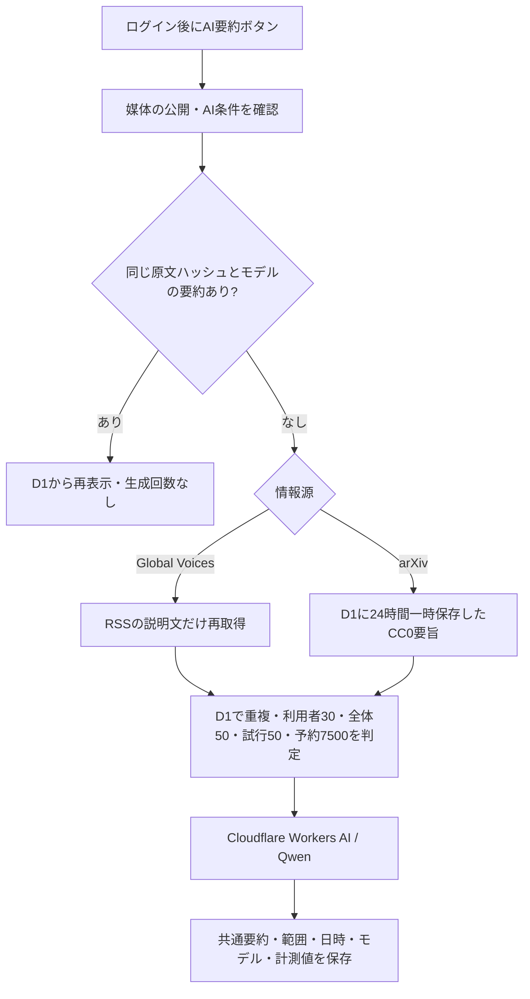

> 最新状態（2026年10月15日の利用者指定による変更）：新規要約は1人30件・全体50件／日。対象はYahoo!ニュース、ITmedia AI＋、ITmedia NEWS、ITmedia ビジネスオンライン、SmartNews、日経電子版の6媒体だけです。取得・公開・AI要約の許諾確認中で、ニュース収集は停止中。財務省・金融庁・Global Voices・arXivは取り下げ、記事・要約を非表示にしました。従来の配信元と5件／20件の記述は当時の履歴です。現在の方法・AI可否・代替案は[指定6媒体の確認書](指定6媒体の取得方法・AI要約可否.md)を参照してください。

# AI・問い合わせ・復旧の運用手順

2026年10月15日の実装と実測に基づく。作業フォルダは `C:\Users\ユーザー\OneDrive\ドキュメント\news-pocket`。コマンドはこのフォルダのPowerShellで実行する。Node.js 24を使う。

## 現在の接続と実測

| 項目 | 実際に確認した結果 |
|---|---|
| AI | Workers AIを接続。現在は `@cf/qwen/qwen3-30b-a3b-fp8` |
| 品質 | 最初のLlamaで3件生成し、1件の断定表現を不合格として除去。Qwenで日本語の政治・AI記事と英語の研究要旨の3件を照合。固有名詞・数値・断定の程度を確認した。全記事の品質を保証する検査ではない |
| AI実行時間 | Qwenの3件は709ms、689ms、1,838ms。AIサービス呼び出し部分の時間で、RSS取得・通信・DB処理を含む画面全体の待ち時間ではない |
| 共通要約 | 未ログインで同じ要約を3回取得。99ms、92ms、89ms。AI試行数は6のまま増えなかった |
| 本番の上限 | 比較生成を含む当日の成功5回のあと、新しい記事の生成を拒否。AI試行数は増えない。閲覧・記事保存は引き続き利用可能 |
| Neurons | 6回のモデル応答のトークン数からの推計は合計20.4709。本人のCloudflare画面で20.47 / 10kを確認し、6回分の推計と小数第2位まで一致。無料枠の約0.20％ |
| 定期収集 | [実行38728448868](https://github.com/iori-doiya/news-pocket/actions/runs/38728448868)はTriggered via schedule・Success。20:17予定、ジョブ開始20:35:47、収集成功20:35:58（日本時間）。約19分遅延。2情報源版での実績 |
| 4情報源版 | mainへ統合後、[手動実行38731693084](https://github.com/iori-doiya/news-pocket/actions/runs/38731693084)で財務省100・金融庁15・Global Voices46・arXiv10件の取得と100件の登録に成功。21:03:02（日本時間）。これはschedule実績とは区別する |
| Google公開 | ブランディング未入力で公開ボタンが無効だった。本人がホーム・プライバシー・利用案内のURLを保存し、対象者の公開ステータスが「本番環境」になったことを確認。ブランド審査済みという意味ではない |
| 非公開問い合わせ | 本番フォーム送信→運営者受信→既読を確認。メール自動通知・自動返信はない |
| 本番削除・復元 | 検証専用ユーザーで本番の削除APIを実行。利用者・セッション・保存・問い合わせが0件になり、旧セッションも失効。バックアップを別の本番D1へ復元して各1件を確認。その検証DBは削除。本人の利用者1件・保存1件は維持 |
| D1容量 | 応答メタデータのsize_afterで315,392 bytesを確認（この時点）。設定画面では実容量と内容からの見積もりを区別する |

短い説明文は、無理に400字へ引き伸ばさない。政治記事のQwen出力は原文の表現をほぼ保持した。研究要旨の日本語出力は238字だった。背景や数字を作り足すより、取得できた範囲を正確に示すことを優先する。

## AIが動く経路



財務省・金融庁の本文はAIへ送らない。Global VoicesはRSS説明文のみで、全文・写真・第三者の埋め込み投稿は使用しない。arXivは要旨のみで、論文PDF・全文は取得しない。arXivの要旨は24時間で新規生成に使えなくなり、次の定期整理で物理削除する。作成済み要約は記事の保存期間内で共通利用する。

arXivは公式APIが全機械合計で3秒以上の間隔・単一接続を求める。収集は毎時1回・10件とし、取得前に本番D1で共通の取得許可を確保する。閲覧者ごとに外部APIを再取得しない。間隔違反時は取得を拒否して失敗として記録する。

## 無料枠と回数を確認する

1. 公開サイトの「設定」を開く。「あなたの本日の成功回数」「サイト全体の成功回数」「UTC本日の試行・予約・トークンからの推計」を確認する。予約値は実消費ではない。
2. [Cloudflare Workers AIの使用量](https://dash.cloudflare.com/4ae1522bad207d759fccd6882ff74554/ai/workers-ai/usage)を開く。「Neurons」を選び、Neurons used todayの値を確認する。1日の無料枠は10,000。グラフは反映に時間がかかる場合がある。
3. Workers & Pages → news-pocket → Metricsでリクエスト・CPU、Storage & databases → D1 → news-pocket-dbで容量・読み書き量を確認する。全アカウントの他サービスの消費も共有枠に影響する。
4. Paidへの切り替え、カード登録、AI Gatewayの有料機能は不要。このアプリに有料プランへ自動変更する処理はない。

利用者とサイトの成功回数は日本時間0時、AI処理量はUTC0時（日本時間9時）に切り替わる。失敗・品質検証で除去した出力でも処理量は消費するので、試行と予約を消さない。AIサービスの実行に失敗したら、そのUTC日は新規生成を停止する。

[公式料金](https://developers.cloudflare.com/workers-ai/platform/pricing/)では現在のQwenは入力100万トークンあたり4,625、出力100万あたり30,475 Neurons。アプリの推計はこの単価を使う。実使用量の代わりにはしない。新しい試行は1回150の保護用予約と1日7,500の枠を設け、入力8,000文字・出力900トークンに制限する。Freeでは10,000超過に有料化が必要で、無料のまま超えれば呼び出しが停止する。意図的に無料枠を使い切る実験はしていない。上限エラーを受けた場合の停止は模擬AIとD1のテストで確認した。

## AIの接続・停止・更新

今回、`wrangler.jsonc` の `ai.binding=AI` と `AI_ENABLED=true` を登録済み。外部AI用のAPIキーは不要。秘密をブラウザに渡さない。

停止する場合は `wrangler.jsonc` の `vars.AI_ENABLED` を文字列 `"false"` に変更し、次を実行する。

```powershell
npm run check
npm test
npm run build
npm run deploy
```

成功すると新規生成ボタンが出なくなる。現在の同一モデルで作成済みの要約は読める。モデル変更時は `src/model.mjs` のFREE_MODEL、wranglerのAI_MODEL、workerのNeurons単価、テスト、説明書を同時に更新し、利用条件・無料対象・品質を再検証する。古いモデルの要約は現在のモデルの要約として再利用しない。

## 非公開問い合わせを読む

1. [公開サイト](https://news-pocket.iori-sato-4637.workers.dev)で、今回の運営者のGoogleアカウントにログインする。
2. 設定 → 問い合わせ先、または [問い合わせフォーム](https://news-pocket.iori-sato-4637.workers.dev/contact.html) を開く。
3. フォームの下の「運営者専用の受信箱」を確認し、「受信箱を更新」を押す。件名・本文・任意の返信先・送信時刻が表示される。「既読にする」で状態を変えられる。
4. 返信が必要なら自身のメール等から個別に対応する。このサイトはメールを送らず、自動通知もしない。受信箱は運営者自身が定期的に開く。

運営者の照合にはGoogle識別子のSHA-256を使い、Cloudflare Secretsの `ADMIN_SUB_HASH` に保存する。生のGoogle識別子やメールを公開コードに書かない。サーバー側で毎回認証し、他の利用者・未ログイン者の受信箱APIは403になる。初回の `npm run connect:operator` は本番利用者が1人の場合だけ設定でき、今回実行済み。現在は再実行不要。

問い合わせは1IPにつきUTC日3件、全体50件まで。IPアドレスそのものは保存せず、日付と秘密鍵で変換した照合値を最大2日保持する。本文・返信先は30日で整理する。ログイン中に送った問い合わせはアカウント削除にも連動する。匿名の問い合わせにはアカウントを結び付けない。秘密値・認証コードを書かないようフォームで案内する。

## 本番の削除・復旧を検証した方法

既存利用者を削除する方法は選ばず、本番DBに検証専用ユーザーを作った。Googleアカウントを新規に作ったわけではない。検証用セッションで実際のDELETE /api/accountを呼び、本人の行・保存・全セッション・関連問い合わせが消えることを確認した。Googleによる実ログインは別途確認済みだが、ご本人の本アカウントを削除するUI操作は行っていない。

`scripts/recovery-drill.mjs` は対象を自分で作った検証専用IDに限定する。秘密のセッション値とSQLはGit除外した `.secrets/` だけに保存する。実施した順序は次のとおり。

```powershell
node scripts/recovery-drill.mjs seed
node scripts/recovery-drill.mjs backup
node scripts/recovery-drill.mjs delete
node scripts/recovery-drill.mjs restore
node scripts/recovery-drill.mjs cleanup
```

seedは検証用ユーザー・保存・問い合わせを各1件作成。backupは本番をSQLへ保存。deleteは本番の削除APIと旧セッション失効を検査。restoreは**別の新しいD1**へ読み戻し、各1件の復元を検査。cleanupはその検証DBだけを削除する。今回の状態ファイルが残っている間は二重seedを拒否する。通常運用で毎回実行するコマンドではない。

本人の利用者と保存は各1件を維持した。公開先のDBを過去へ巻き戻していない。D1 Time Travelの復元地点も読み取れたが、実サービスを巻き戻すrestoreは実行していない。

0004追加後には `node scripts/recovery-drill.mjs verify-current` も実行し、現在の全表を別の新しいD1へ復元した。利用者1・保存1・記事152・要約4・問い合わせ1・一時要旨10・計測6の件数一致を確認し、その検証DBは削除した。私有SQLはこのPCの`.secrets/`に保管し、Gitには送っていない。SQLには復元用の個人データが含まれるため共有しない。長期バックアップの自動作成・自動削除は実装していない。検証SQLが不要になったら、対象ファイル名を確認して削除する。

実際に誤更新・誤削除から戻す場合は、収集を停止し、現時点のDBをバックアップしてから、復元先と影響を確認する。全体復元は他の利用者の新しい保存・削除まで戻すおそれがある。削除済み個人情報を戻した場合は再削除が必要で、セッションも失効させる。FreeのTime Travelは7日間が上限。[公式Time Travel](https://developers.cloudflare.com/d1/reference/time-travel/)

## エラーと今回の修正

| 表示・現象 | 原因と対処 |
|---|---|
| AI呼び出し前の503 | Workersがredirect:errorを受け付けなかった。manualへ変更し、転送は追わず3xxも拒否。実Workersエンジンの回帰テストを追加 |
| 政治要約が原文より強い断定 | Llamaの出力を除去し、無料対象のQwenと指示を再検証。成功扱いの出力は下げても処理量の記録は残した |
| 422 要旨期限切れ | arXivの24時間キャッシュが切れた。次の定期収集を確認。PDF取得や見出しからの推測はしない |
| 429 本日の新規要約30件 | 日本時間0時まで新規生成を待つ。作成済みの閲覧と保存は可能 |
| Googleの公開ボタンが押せない | ブランディングが未完了。ホーム・プライバシー・利用案内を保存した後に対象画面で公開できた |
| 定期収集が予定時刻に動かない | GitHubの遅延を実際に確認。Actionsのイベントと成功日時を確認し、手動成功と区別する |

## 残る確認

- 初回scheduleは2情報源版で成功。4情報源版のGitHub手動確認も成功。次回の4情報源版scheduleはこの記録時点では未観測で、手動実行で代替したとは扱わない。
- 最後のAI生成を含めて20.47 / 10kの反映を本人の画像で確認済み。
- 芸能は海外の映画・音楽記事が中心で、配信が古い場合がある。最新の国内芸能を日々網羅する状態ではない。
- Googleのブランド審査完了、別の実Googleアカウント、物理スマホでの指操作、全記事のAI品質は未確認。
