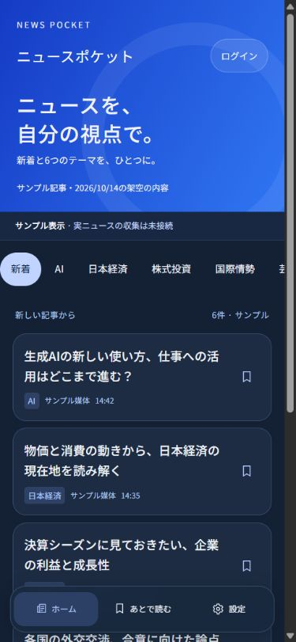
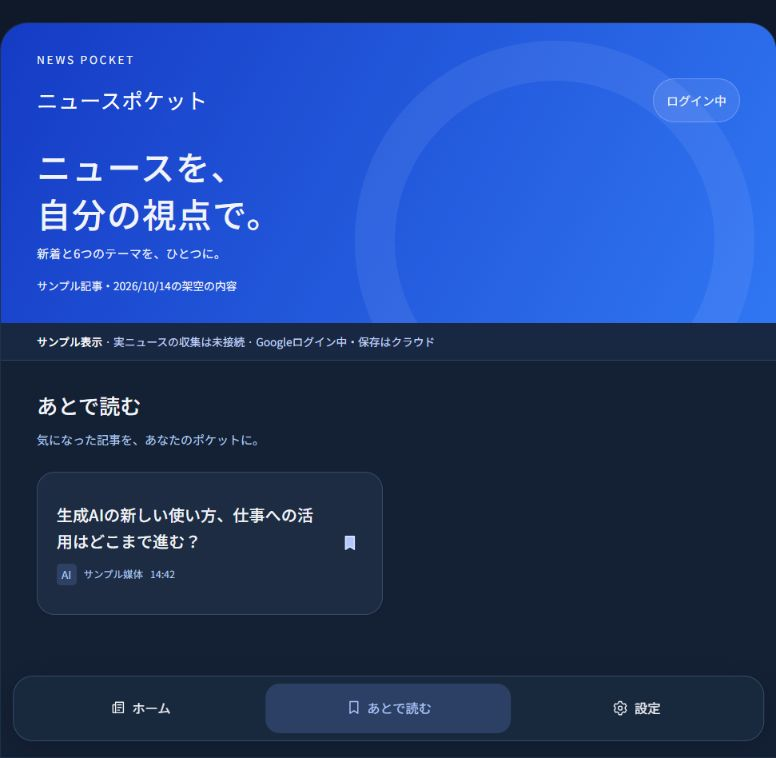
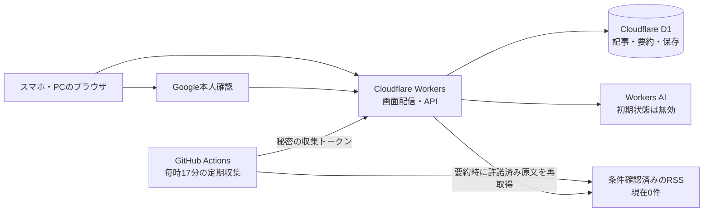

# ニュースポケット 制作記録・運用手順書

記録開始・最終照合：2026年10月15日（日本時間）。初期版0.1.0の実装に対応。**Cloudflare公開、本番Googleログイン・D1保存・再ログイン後の復元を確認済み。実ニュース配信・実AI生成は未接続。**

公開URL：[ニュースポケット](https://news-pocket.iori-sato-4637.workers.dev)。制作の各工程では、その時点の完了・未完了を記録している。最新の状態は第1部13と末尾の未完成事項を参照。

## 第1部：実際にどう作ったか

### 1. 資料と作業場所の確認

指定された `C:\Users\ユーザー\OneDrive\ドキュメント\news-pocket` には、reference内の仕様書とPNG画像のみがあった。既存のアプリやGit管理はなかった。別の作業用フォルダでファイルを作り、検証後に指定フォルダへ配置する。

仕様書v1.0と画像を読んだ。紺色の背景、青いグラデーション、画像を使わない記事カード、7つの横スクロールタブ、3つの下部メニューを確認。添付画像の時刻を実稼働の時刻として使わない。候補媒体はすべて権利未確認として無効にする。

### 2. 構成の決定と初期ファイル

ブラウザ画面はHTML・CSS・JavaScriptとした。HTMLは画面の構造、CSSは見た目、JavaScriptは操作を担当する。フロント用のビルドを不要にし、初心者が配色や文章を変更するファイルを追いやすくした。サーバーはCloudflare Workers（クラウドでAPIを動かす仕組み）、D1（SQLite互換のデータベース）、Googleの本人確認、GitHub Actions（クラウドの定期作業）、Workers AIで構成する。

`package.json`、`wrangler.jsonc`、秘密情報を除外する`.gitignore`、`config/sources.json`を作成。DATA_MODEはsample、AI_ENABLEDはfalse。情報源ごとに収集・公開表示・本文取得・AI入力・要約提供の可否を独立して記録した。実サービスへのログイン、D1作成、公開はまだ実施していない。

### 3. サンプル画面と操作を作った

`public/index.html`にヘッダー・本文の入れ物・下部メニュー・ダイアログ（画面上に開く案内）を作り、`public/styles.css`で背景#142034、カード#1D2C42、ヘッダー#153BC4→#3076F3、丸み・境界線・余白を設定した。ヘッダーの円はCSSの疑似要素（HTMLを追加せず飾りを表示する機能）で描いた。デザイン画像を背景として貼り付ける方法は使っていない。アイコンは小さなSVG（線や図形で表す画像形式）。文字はHTMLの文字、見出しはリンク、保存やログインはボタンである。

`public/app.js`で7テーマ、新着一覧、記事詳細、あとで読む、設定を作った。タブは折り返さず、その部分だけを横へスクロールする。左右のキーでも移動できる。狭い幅は1列、640px以上は2列の記事配置。サンプル本文は`src/samples.mjs`に手作業で6件用意し、AI生成と区別した。

未ログインの保存操作で案内を開き、サンプル版だけに端末内のデモを用意した。デモはlocalStorage（同じブラウザ内にデータを置く仕組み）を使う。Googleにログインした表示やクラウド同期の表示を出さない。

**確認結果：**ブラウザでテーマの絞り込み、末尾の日本政治タブ、記事詳細、戻る、デモ保存、あとで読む、再読み込み後の保存維持、設定、デモ終了を確認。サンプルに実際の元記事がないので、架空の元記事リンクは作らなかった。実機の指によるスワイプはまだ確認していない。

### 4. サーバー・認証・保存を作った

`src/worker.mjs`にAPI（ブラウザとサーバーのデータ受け渡し窓口）、`migrations/0001_initial.sql`にD1の表を作る命令を書いた。D1には記事、共通要約、利用者、セッション、利用者ごとの保存、要約の生成枠、収集状態を分けて保存する。

`src/auth.mjs`でGoogleのOAuth/OpenID Connect（Googleに本人確認を頼み、結果を受け取る規格）を実装。認証の通信を保護するstate・nonce・PKCEと、Googleの署名を確認するjoseライブラリを使った。ユーザーの氏名やメールアドレスを不要に取得しないため、要求範囲はopenidだけにした。

セッションの値をそのままDBへ保存せず、SHA-256のハッシュ（一方向の変換結果）を保存する。ブラウザのCookieはHttpOnly（画面のJavaScriptから読めない）、SameSite=Lax（外部サイトからの一部のCookie送信を制限）、本番はSecure（HTTPSだけで送信）にした。書き込み時はセッションに加えてOrigin（操作元のサイト）を照合する。

**確認結果：**ログインが必要な操作の拒否、別の利用者の保存が見えないこと、外部サイトからの操作拒否、削除時の保存・セッションの連動削除を架空の認証済みデータでテストした。Googleの実アカウントによるログインや別端末同期は実施していない。

### 5. 収集とAIの無料枠保護を作った

`src/feed.mjs`でRSS/Atom（記事見出し・URL・日時などを配信する形式）を解析し、`src/model.mjs`でテーマ分類・URL整理・上限値を共通化した。`scripts/collect.mjs`は有効な情報源だけを取得し、本文を送らず、タイトル・URL・日時・テーマ・本文のハッシュを認証付きAPIへ送る。GitHub Actionsを毎時17分に設定した。公開リポジトリ・標準Ubuntuの実行環境だけに限定し、成果物やキャッシュの蓄積を設けなかった。

要約は表示しただけで新規生成しない。ログイン済みの利用者がボタンを押し、情報源の条件とAIの設定がそろっているときだけ生成する。D1のトリガー（登録時に自動実行する制約）で5件/人・20件/サイト、失敗を含む30試行、UTC日の予約枠7,500を同時に判定する。記事ごとの生成中の行を1件に制限して、同じ記事の重複生成を防いだ。

8,000文字を超える原文を途中だけで要約する方法は採用せず、生成を止めて理由を表示する。本文がない場合も見出しから推測しない。AIの実行が失敗すると成功回数を増やさず、消費の再試行を防ぐためUTCのその日中はサイト全体の新規AIを停止する。要約の候補モデルは無料対象の`@cf/meta/llama-3.1-8b-instruct-fp8-fast`だけに固定し、初期設定は無効にした。

**確認結果：**模擬RSS・模擬AIで重複登録、失敗時の最終成功時刻据え置き、原文なし・長文の拒否、同時生成でAIが1回しか呼ばれないこと、成功回数・試行数・UTC予算の制限を確認。実際のRSSの収集やモデル品質・速度・Neurons消費量の実測はしていない。

### 6. 実行環境の問題を修正した

| 起きた問題 | 原因・修正 | 学べること |
|---|---|---|
| npmのライブラリ取得がENOTFOUNDで失敗 | 作業環境のネットワーク制限。許可された実行で公式npmから取得した | サイトのコードとネットワーク環境の失敗を分ける |
| Node.jsのバージョン警告 | PCの既存Nodeは20.14.0。Wranglerは22以上を要求。検証はCodex同梱24.19.0を明示して使用。start.ps1も古いNodeを検知するようにした | npmとnodeが別のパスを使う場合がある。node --versionで確認する |
| Wranglerのログを書けない・ローカル実行に通信できない | 制限環境外の設定フォルダに書こうとした。ローカル実行ではXDG_CONFIG_HOMEをフォルダ内の.wrangler/configへ設定。ローカルエンジン通信を許可して検証 | 本番ログインをしていなくても、開発ツールは設定とローカル通信を必要とする |
| 容量計算のPRAGMAがSQLITE_AUTH | D1はSQLiteのすべての命令を許可しない。page_count/page_size/freelist_countをやめ、文字列のバイト数と行数から3倍の余裕を加える見積もりへ変更 | 通常のSQLiteテストだけではD1固有の制限を見つけられない |
| 容量集計のUNION ALLがD1で失敗 | 複合SELECTの制限に当たった。個別の小さな集計を足すSQLへ変更 | 実際の実行エンジンでもテストする |
| Miniflareの互換性日付・設定APIが合わない | 旧4系のエンジンでは今回の日付に未対応。Wranglerが使う5.20261012.0-betaへ揃え、公式のconvertV4MiniflareOptionsを利用 | 開発用ライブラリ間のバージョンを揃える。lockファイルを保存する |

依存関係は`package-lock.json`に固定された取得結果を保存した。通常の再取得にはnpm installではなくnpm ciを使い、同じ組み合わせを再現する。公開前には依存ライブラリの更新を別作業として確認する。

### 7. 最終の確認と配置

指定のnews-pocketフォルダへアプリ・起動スクリプト・ライブラリを配置し、referenceは変更しなかった。そのフォルダでローカルD1に19個の初期命令を適用し、Wranglerのローカルサーバーを起動。APIと静的画面が動くことを確認した。

自動テストは12件成功。構文確認と公開用のdry-run（公開せずにファイルをまとめる確認）も行った。ブラウザの実際のCSS表示幅320px・390pxで本文の横はみ出しがなく、タブの中だけが横へ動くことを確認。1222pxで2列の記事配置を確認した。ブラウザの表示倍率があるため、ツールへ指定した幅とCSS上の幅が違い、画面の実測値で判断した。物理スマホでのタッチ・Google実認証・本番のCPU時間・AI品質は未確認。



完成したのは、画面、サンプル操作、接続後に使うAPI・設定・収集・無料枠保護・手順書。残ったのは外部アカウントへのログイン、D1の本番作成、情報源の許諾、実測と本番公開。GitHubへのpushや外部公開は行っていない。

### 8. 「開けない」という連絡への対応

同日、ユーザーからローカルURLが開けないとの連絡を受けた。8787番ポートに待ち受けがないことを確認。初回実装の検証終了時にサーバーを停止していたのが原因だった。start.ps1を指定フォルダから実行し、既存ローカルDBをそのまま使って再起動した。ブラウザで6件のサンプル記事が表示されることを確認し、今回はユーザーが閲覧できるようサーバーと画面のタブを残した。

アプリコードの修正は不要だった。READMEへ「localhostはサーバー起動中だけ開ける」「Ready onを確認してから再読み込みする」という案内を追記した。PC再起動や開発サーバー終了後は再起動が必要。本番URLの公開はこの対応では行っていない。

### 9. Cloudflareへの接続を開始した（開始時の記録）

ユーザーがCloudflareへログインし、提示された画面でWorkers & Pagesと既存のworkers.devサブドメインを確認できた。プロジェクト一覧は空だった。画面のリクエスト枠は100,000と表示されていたが、課金プラン自体の確認が済んだとは扱わず、FREE_PLAN_CONFIRMEDはfalseのまま維持した。

公開ツールWranglerのwhoamiを実行し、ブラウザではログイン済みでも、このPCのコマンド用認証は未接続だと確認した。そのため公式のwrangler loginを起動し、ユーザー本人が許可する認証画面を開いた。要求する権限をaccount:read、user:read、workers:write、workers_scripts:write、d1:writeに指定した。Wranglerはログインを維持するoffline_accessも追加する。

この段階では認証の完了をまだ確認していなかったため、D1を作成した、公開した、無料プランを確認済み、といった扱いにはしなかった。認証後の実施結果は次の工程に記録する。秘密の認証値は手順書や公開コードへ記録しない。

このPCでは既存Node.jsが古いため、実行時は同梱Node.js 24からnode_modules/wrangler/bin/wrangler.jsを直接呼んだ。今回の本番向けログインはWrangler既定のユーザー設定保存先を使い、ローカル開発用の.wrangler/configとは分けた。通常のNode.js 24を用意したPCでは、第3部のnpx wrangler loginと同じ目的の操作になる。[公式loginコマンド](https://developers.cloudflare.com/workers/wrangler/commands/general/#login)

### 10. 本番D1を初期化し、サンプル版を公開した

ユーザーが認証画面で許可し、WranglerのSuccessfully logged inを確認。whoamiで画面と同じアカウントへの接続を照合し、d1 listが空であることを確認してからnews-pocket-dbをAPACに作成した。既存データベースはなかった。binding名はアプリが使うDBを維持し、実際に返されたdatabase_idとアカウント識別子をwrangler.jsoncへ反映した。これらの識別子はAPIキーではない。公開先APP_ORIGINも実際のworkers.dev URLへ変更した。

**本番で初めて見つかったSQLの問題：**最初のdb:remoteはincomplete inputで失敗した。sqlite_masterを読み取り、アプリの表が作られていないことを確認してから修正した。要約上限用トリガーのSELECT CASE ... ENDをSELECT (CASE ... END)へ変更すると、同じSQLの19命令が本番でも成功した。D1のトリガー分割がCASEのENDを解釈し違える既知の報告とも一致する。上限そのものは変更していない。[Cloudflareのissue #4727](https://github.com/cloudflare/workers-sdk/issues/4727)

初期SQLは本番未適用だったためそのファイルを修正できた。今後すでに適用した表や制約を変える場合は、新しいmigrationを追加する。Windowsの改行による別の不具合も避けるため、.gitattributesにmigrations/*.sql text eol=lfを追加した。修正後に12テストを再実行して全件成功。本番でもsummary_quotaとarticle_job_detachのトリガー、0001_initial.sqlの適用記録を読み取り確認し、利用者・記事が0件であることを確認した。

**無料枠の確認と案内の修正：**請求APIは今回の認証権限で403となり、契約一覧を自動では取得できなかった。ユーザーの画面で日次100,000回の上限を確認し、公式のWorkers Freeの制限と照合した。さらに表示された画面はWorkers Paidへの変更申込みだった。ここからFree枠の表示と判断し、FREE_PLAN_CONFIRMEDをtrueにした。APIで課金プラン自体を確認済み、という意味ではない。[公式の制限](https://developers.cloudflare.com/workers/platform/limits/)

この途中で、確認用としてUpgradeボタンを案内したところ有料契約の入力画面になったため、入力や契約をせず戻るよう案内を訂正した。Upgradeは契約の確認専用ボタンではない。有料への変更、支払い、カード情報の登録は実施していない。今後も無料運用のために有料契約を結ぶ必要はない。

DATA_MODE=sample、AI_ENABLED=false、情報源全件無効を維持して、公開前検査スクリプト経由でデプロイした。静的アセット4件のアップロード、Workerの公開、workers.devの反映が成功。バージョンIDはe3862e7b-b49d-4f8e-ad5b-465cf9f030f9。Worker起動時間は公開ツールの表示で2msだった。これは起動時間であり、実ニュース処理やAIの実行時間を測った値ではない。

公開ホーム、/api/status、/api/articlesがHTTP 200。mode=sample、database=available、google=unconfigured、ai=disabled、有効情報源0件、サンプル6件を確認した。ブラウザでも公開版の6記事を表示できた。Googleの秘密情報、収集トークン、AIバインディングはまだ登録していない。

これにより普通の閲覧にはlocalhostや自宅PCの起動が不要になった。localhostのデモ保存と公開URLのデモ保存は、ブラウザの保存領域がURLごとに分かれるため別扱いになる。

### 11. サンプル版へGoogleログインを接続した

最初に公開URL、`src/auth.mjs`、保存APIと公開設定を確認した。従来は認証に`DATA_MODE=live`が必要だった。しかし情報源の条件は未確認なので、認証だけのために実ニュースへ切り替えるのは不適切だった。そこで`AUTH_ENABLED`を追加し、記事モードと認証の有効化を分けた。初期値はfalseのまま。

Googleログイン後は、架空のサンプル記事も利用者別にD1へ保存できる処理を作った。最初の保存操作時に、既知のサンプル記事の見出しとサイト内リンクをD1へ登録する。画面に架空の元記事リンクは表示しない。手作業の説明文を使い、サンプルのAI生成APIは拒否する。実ニュースへの切り替え後はサンプル保存を非表示にし、整理処理で削除する。

`public/app.js`では本物のログインを端末内デモより優先し、ログイン後にデモを自動再開しないようにした。`public/privacy.html`と`public/terms.html`には実装した情報の扱い・制限・未接続事項を記載した。問い合わせ先は未設定のままで、本運用前に用意する。

Google Cloud Consoleで専用プロジェクト`news-pocket`（ID：`news-pocket-511705`）を作成。概要画面では「読み込めませんでした」が出たが、ブランディング画面から開始すると登録フォームを開けた。アプリ名はニュースポケット、対象は外部・テストモードにした。本人の確認を受けてサポートメールを選択した。開発者連絡先への同じメールの入力は別用途として自動承認審査に拒否され、追加確認を依頼した。個人のメールの値は記録しない。

秘密情報の登録には`npm run connect:google`を用意した。Googleから取得する設定JSONをローカルで読み、シークレットを公式Wranglerの標準入力からCloudflareへ登録する。値は画面へ出さない。署名用のSESSION_SECRETは未登録の場合だけランダム生成する。公開設定へ書くのは公開クライアントIDとAUTH_ENABLEDだけ。ダウンロードファイルは`.secrets/`に置き、Gitの対象から除外する。

その後、本人の承認を受けて開発者連絡先を入力し、Googleのユーザーデータに関するポリシーにも同意して登録した。管理画面に「OAuth の構成を作成しました」と出たことを確認。次のOAuthクライアント作成・一覧画面は本文が読み込まれず、発行は完了していない。Google管理画面をdocsへ保存する試みは、個人情報が写る可能性として自動承認審査に拒否された。個人情報を公開文書へ含めないため、画像は残さず文章で記録する方針とした。

**確認結果：**14件の自動テストと公開前ビルドが成功。最初のテストでは実行制限により127.0.0.1への接続がEACCESで拒否されたが、許可された環境で再実行するとローカルD1を含めて全件成功した。テストを省略したり、失敗を成功と数えたりしていない。Cloudflareへの公開はAPIホストの名前解決エラーで停止。DNS調査も自動承認審査が時間内に終わらず実行できなかったため、ネットワーク設定が原因だとは断定していない。

Cloudflareへの更新を再試行すると成功した。追加した静的ファイル3件をアップロードし、バージョン`4d333d42-886b-4131-aae1-c206c509c4d1`を公開。状態APIはサンプル・D1応答あり・Google未接続・AI無効・情報源0件、記事APIは6件、プライバシーと利用案内はHTMLでHTTP 200だった。Googleクライアント一覧は読み直してもエラーのため、本人の普段のChromeでも表示を確認してもらう段階。クライアント発行・秘密情報登録・実ログインが済むまで、接続済みとは扱わない。具体的な登録操作は第3部と[Googleログイン接続手順](Googleログイン接続手順.md)を参照。

クライアント画面も再試行後に回復した。「ニュースポケット Web」というウェブ用クライアントを用意し、承認済みリダイレクトURIを公開サイトの`/api/auth/callback`だけにした。JavaScript生成元は空欄、AIエージェント用のチェックは付けていない。本人の承認後に作成し、「OAuth クライアントを作成しました」を確認した。

JSONのダウンロード完了を待つ操作は時間切れになり、Downloadsにも該当ファイルがなかった。そこで、発行結果に画面表示されたクライアントIDと秘密を、値を出力せずGit除外済みの`.secrets/google-oauth.json`へ直接保存する方法に変更した。秘密はブラウザの表示以外から推測・取得していない。`scripts/connect-google.mjs`でCloudflareへ登録でき、指定のnews-pocketフォルダの`.secrets/`へ設定ファイルを保管した。公開設定へ保存したのは公開クライアントIDとAUTH_ENABLED=trueだけ。

バージョン`1445df0d-2287-4261-bc70-5e35533babae`の公開が成功。状態APIでgoogle=configured、サンプル・D1応答あり・AI無効・情報源0件を確認。実際のGoogleログインを開始し、アカウント選択とopenidの同意画面まで到達した。初めてアカウントを関連付ける最終同意について、本人の確認を依頼した。

本人の承認後、Googleの最終同意を進めると公開サイトの設定へ戻り、「Googleでログインしています」「本人確認済み」と表示された。ホームからAIのサンプルを保存し、「あとで読む」に表示され、再読み込み後も維持された。ログアウトすると保存一覧がログイン案内へ切り替わった。同じアカウントで再ログインすると同じ保存記事が復元された。

本番D1も個人の値を取得せず件数だけ確認し、利用者1件・保存1件・D1内のサンプル記事1件・AIジョブ0件だった。これは本番でGoogle認証と保存が成功した確認であり、別端末や別Googleアカウントで実機確認したという意味ではない。利用者分離は架空の2利用者での自動テストが成功。本番のアカウント削除は実行していない。GoogleのProductionへの変更とブランド確認、一般公開向けの問い合わせ先整備は未完了。



### 12. 利用者の環境で保存表示を確認

普段使うChromeまたはスマホで、公開URLを開き同じGoogleアカウントでログインし、「あとで読む」に先ほど保存したサンプルが見えるか確認を依頼した。2026年10月15日、利用者から「後で読むに表示されてた」との報告があった。利用者の環境でも保存を読めたことを確認済みに追加した。端末の種類・機種・OSまでは聞いていないため、物理スマホでのタッチ操作や特定の機種で検証したとは書かない。

続けてGitHubの接続準備を確認した。接続ツールからGitHubアカウントのログインを取得できた。コード保存用の接続先はローカルにまだ登録されておらず、予定のnews-pocketリポジトリもツールでは取得できなかった。リポジトリの作成・コードの公開・収集の稼働は、この読み取り確認だけでは完了していない。

### 13. GitHubへコードを保存し、手元のフォルダを接続した

最初にGitHubのログイン、既存リポジトリの取得可否、ローカルの接続先、ワークフローを確認した。定期収集は公開リポジトリかつCOLLECTION_ENABLED=trueだけで動き、検査は公開リポジトリのpush・PRで動く構成だった。標準のGitHub実行環境を使い、成果物・キャッシュを追加保存しない。

公開対象40ファイルに秘密が混ざらないことを確認し、reference原本も.gitignoreへ追加した。本人へコードと手順書が一般公開されることを説明し、承認後に`iori-doiya/news-pocket`をPublicで作成。初期READMEの後、40ファイルをまとめたコミット`acca426fd9fa6027dd2883d3a24c3118387d3266`をmainへ保存した。画像1件の転送が一時失敗したが、同じファイルの再送に成功し、欠落なしで登録した。

指定フォルダには既存のGit履歴がないことを確認し、main・originを作成。公開リポジトリの履歴を取得し、手元のファイルを上書きしないmixed方式で履歴を対応付けた。コミットの名前とメールはGitHubのユーザー名・noreply（個人のメールを公開しない連絡先）をローカル設定で使用する。公開対象に入っていないローカル画像は送信しない。

照合すると、指定フォルダのstart.ps1にはUTF-8 BOM（Windows PowerShellが日本語の文字コードを識別する印）があり、公開候補側には付いていなかった。公開用へ同じ印を加え、Windows PowerShell 5.1の構文解析でエラー0件を確認。Linux上のNodeテストだけでは、このWindows用の文字コード差を検出できないと分かった。

GitHubのActions画面は通信エラーになり、Windowsから公開APIへ接続した際も名前解決に失敗した。Gitの公開リポジトリ取得と接続ツールからの保存は成功している。自動検査の結果は、実際に取得できるまで成功と記録しない。Windows起動の修正と接続手順の更新をPR（プルリクエスト：変更を確認し、検査してから本流へ取り込む仕組み）で整理する。

その後、[PR #1](https://github.com/iori-doiya/news-pocket/pull/1)でGitHubの自動検査を確認できた。[Verify codeの実行](https://github.com/iori-doiya/news-pocket/actions/runs/38691068969)は構文確認、14テスト成功・失敗0、公開前ビルドの全項目で成功。ログの実際の件数を確認した。Windows PowerShell 5.1の構文確認とは別の検証結果として記録する。

設定画面も新しいタブでは表示できるようになった。Settings → Secrets and variables → Actions → Variablesで、COLLECTION_ENABLED=falseとSITE_URLを登録し、一覧に2項目が表示されることを確認。INGEST_TOKENはまだ登録していない。収集ジョブは停止しており、これをニュース収集成功とは数えない。情報源の条件確認と実ニュースへの切り替えが済むまで定期収集を開始しない。

## 第2部：完成したサイトの仕組み

### 全体の構成



WorkersとD1をクラウドへ接続し、サンプル版を公開したので、普通の閲覧に家のPCの常時起動は不要になった。静的ファイルは画面用の公開ファイル、Workerは処理を行うサーバー。D1はデータを永続保存する。Googleの本人確認も接続し、本番でログインと保存を確認した。GitHubにはコードと履歴を保存したが、定期収集は未接続。Workers AIは条件を満たした記事の共通要約を担当する設計で、無効を維持している。

### フォルダ・主要ファイル

| ファイル | 役割・変更するとき |
|---|---|
| reference/ | ユーザーが用意した仕様書と画像。今回変更なし |
| public/index.html | 画面の基本構造・サイト名・コピー・読み込み |
| public/styles.css | 色、字体、余白、カード、横タブ、画面幅の調整 |
| public/app.js | 各画面、クリック操作、デモ保存、API呼び出し |
| public/_headers | CSPなどのブラウザ側保護。CSPは許可するスクリプトや通信先を制限する仕組み |
| src/samples.mjs | 架空の記事と手作業の説明文 |
| src/worker.mjs | 一覧・認証状態・保存・要約・収集登録・容量整理のAPI |
| src/auth.mjs | Googleの本人確認とセッション処理 |
| scripts/connect-google.mjs | 私有JSONを読み、秘密の値を表示せずCloudflareへ登録する |
| public/privacy.html・terms.html | Google登録と利用者向けの公開案内 |
| src/feed.mjs | RSS/Atom取得、容量・形式チェック、記事抽出 |
| src/model.mjs | 6テーマ、キーワード分類、URL整理、上限値 |
| config/sources.json | 管理者が確認する媒体別の利用条件と取得設定 |
| migrations/0001_initial.sql | DBの表・索引（検索を速める仕組み）・上限制約 |
| .gitattributes | SQLの改行をLFに固定し、本番D1の初期化で起こる改行由来の問題を防ぐ |
| scripts/collect.mjs | GitHub Actionsの収集処理。本文はファイルやDBへ残さない |
| scripts/deploy.mjs | 公開前に無料プラン確認・本番URL・DB ID・情報源などを確認 |
| scripts/check.mjs | JavaScriptの構文と情報源設定の検査 |
| .github/workflows/collect.yml | 定期収集と手動収集 |
| .github/workflows/verify.yml | GitHubのpush/PR時の確認。自動公開はしない |
| wrangler.jsonc | Cloudflareの接続先と公開してよい設定値。現状はJSON文法で記載 |
| .dev.vars.example | ローカルの秘密設定の項目名のみ |
| .dev.vars | 自分で作るローカル秘密設定。Git管理外 |
| .wrangler/ | ローカルDB・開発ツール設定。Git管理外 |
| start.cmd / start.ps1 | Windowsの簡単起動 |
| package.json / package-lock.json | 起動コマンド・ライブラリ一覧と固定した取得結果 |
| tests/ | 架空データのAPIテストと、本物のローカルD1エンジンのテスト |
| docs/ | 制作記録、運用手順、情報源記録、実装報告 |

### Googleログインと利用者別の保存

ログインボタン → Workerでランダムな認証確認値を作成 → Googleの画面 → 認証コードをWorkerだけで交換 → IDトークンの署名・対象クライアント・有効期限・nonceを確認 → Googleのsub（Googleが付ける利用者識別子）に対応するサイト内IDを作成する。

ブラウザにはランダムなセッションCookie、D1にはそのハッシュと利用者IDを置く。有効期間は7日。保存時はURLの利用者IDや画面の表示を信用せず、Cookieで認証した利用者IDだけを使う。bookmarksの主キーは利用者ID＋記事ID。同じ記事を二重保存しない。解除して再保存すれば新しい保存日時になり、あとで読むは保存日時の新しい順になる。

新しい記事一覧・作成済み共通要約・元記事リンクはログイン不要。保存・新規要約・本人の保存取得・削除はサーバーで認証する。デモ保存は別の仕組みで、D1へ送らない。

AUTH_ENABLEDは本人確認の有効化、DATA_MODEは表示記事の種類を決める別の設定。現在はAUTH_ENABLED=true、DATA_MODE=sample。本物のログイン後にサンプルを保存するとD1を使い、端末内デモの保存は自動で移さない。実ニュースへ切り替えるとサンプル保存は非表示になり、次の整理処理で削除される。

### 収集・分類・要約・表示の順序

1. GitHub Actionsが毎時17分に起動。遅延・漏れがあり、正確な毎時は保証しない。
2. COLLECTION_ENABLEDがtrueで、公開リポジトリであることを確認。管理者の設定から公開条件確認済みの情報源だけを選ぶ。
3. RSSをHTTPSで取得。15秒の取得期限、1MBの取得上限、1情報源100件、1回の登録100件を設定。外部実体を含むXMLは拒否する。
4. URLの追跡用パラメータを整理。見出し・配信カテゴリ・媒体の既定テーマをキーワード分類する。1記事が複数テーマに入ることもある。
5. INGEST_TOKENで保護したAPIへメタデータだけを登録。公開日時が不明なら初回収集日時で並べ、画面に収集日時と表示。URLで同じ記事の重複を減らす。
6. 完全に成功した収集だけがlast_successを更新。全部失敗・部分失敗はlast_attemptと失敗状態を更新し、成功時刻を進めない。有効な情報源0件なら成功扱いにしない。
7. 一覧は30件ずつ取得。見出しから詳細を開き、作成済みの共通要約があれば表示する。新規生成は別のボタン操作。
8. 新規生成時に許諾済みRSSの本文・抜粋を再取得。D1に長期保存した本文から生成する構成ではない。記事がRSSから消えていれば原文不足と表示する。

異なる媒体が同じ出来事を報じても、原則別の記事。RSSの掲載件数・取得時点に依存するため、全記事を漏れなく保持する保証はない。本文のハッシュが変わると古い要約を再利用せず、新しい生成の上限を判定する。取得範囲を要約画面に表示する。

### AIの再利用・回数制限・無料上限

| 上限 | コードでの扱い |
|---|---|
| 利用者の成功5件/日 | 成功と生成中の予約を合算して、開始時に確保 |
| サイトの成功20件/日 | 全利用者の成功と生成中を合算 |
| サイトの試行30回/日 | 失敗した処理も含める。成功枠を返しても試行記録は残す |
| AI予約250/回、UTC日に7,500 | モデル・入力8,000文字・出力900トークンを制限した保守的な予約値。実測Neuronsそのものではない |
| 同じ記事の同時生成 | pendingの行を1件に制限。他の操作は409で生成中を案内 |
| AI実行失敗 | 成功枠は失敗へ変更。UTC日が変わるまで新規AI停止 |
| 途中で処理が消失 | 10分の生成枠の期限を超えると次の定期整理でfailedへ変更。試行量は返さない |

サイトの日次回数は日本時間0時、Cloudflare AIの無料枠はUTC0時（日本時間9時）に切り替わる。両方を別に記録している。AIの実消費はアカウントの他の利用とも共有される。アプリ内の予約だけでアカウント全体を計測することはできない。**0円を守る最終条件は、Workers Freeプランを維持すること。** Paidへ切り替えるとプラットフォーム側で課金し得るため、切り替えない。[公式AI料金](https://developers.cloudflare.com/workers-ai/platform/pricing/)

FREE_PLAN_CONFIRMEDは管理者が確認した記録用のフラグで、課金プランをAPIで自動確認する機能ではない。コードに有料への自動切り替えはない。AIは初期状態で無効。実測で上限への適合を確認してから有効にする。

### 保存期間・容量整理・アカウント削除

通常の記事は収集から90日で削除対象。保存された記事は原則残すが、容量や媒体条件で削除する。媒体ごとにretentionDaysで1〜90日の保持期間、retainSaved=falseで保存記事にも同じ期限を適用できる。情報源を無効化すると即座に公開一覧・要約から非表示にし、次の容量整理でその記事も削除する。許諾が特別な期限・表示要件を含む場合はその条件にコードを合わせる必要がある。

記事10,000件または保存内容から推定した350MiBを超える場合は、公開日時（不明なら収集日時）が古い記事から、保存の有無に関わらず最大1,000件ずつ整理する。推定値は索引・ページなどへの余裕として内容のバイト数・行の固定見積もりを3倍にした値で、実ファイル容量ではない。Cloudflare画面の実容量を必ず確認する。D1は解放した領域を再利用するため、削除で画面上の容量が直ちに縮まる保証はない。

削除は外部キー（関連する行をつなぐDBの制約）で要約・保存参照にも連動する。回数制限を回避しないよう、記事を削除しても当日の生成枠記録は残る。セッションの期限切れと90日以前の完了済み生成記録も整理する。整理はGitHub Actionsから毎回呼ぶため、Actionsを無効にすると定期整理も止まる。ブラウザを開くたびには整理しない。

アカウント削除は確認ダイアログを挟み、ログインから15分以内のセッションで実行。古ければGoogleで再ログインする。本人のユーザー行・保存・全セッションを削除し、共通記事・要約と匿名化した生成枠は残す。Googleアカウントそのものは削除しない。D1 FreeのTime Travel（過去状態の復元）は最大7日間の履歴を保持する。独自の追加バックアップは作っていない。[公式復元仕様](https://developers.cloudflare.com/d1/reference/time-travel/)

## 第3部：自分で操作・修正する手順

### 1. 自分のPCで起動・終了する

エクスプローラーで`C:\Users\ユーザー\OneDrive\ドキュメント\news-pocket`を開く。`start.cmd`をダブルクリックする。必要なライブラリがなければ最初の起動時にインターネットから取得し、ローカルDBを初期化する。`Ready on http://127.0.0.1:8787`が出れば起動成功。ブラウザへ`http://localhost:8787`を入力する。

起動スクリプトはNode.jsのバージョンを調べ、このPCではCodex同梱24.19.0を使える。別PCでは[Node.js公式サイト](https://nodejs.org/)から24 LTSを用意する。通常のPowerShellで操作する場合は、新しいNodeのインストール後にPowerShellを開き直し、次を実行する。

```powershell
cd "C:\Users\ユーザー\OneDrive\ドキュメント\news-pocket"
node --version
npm ci
npm run db:local
npm run dev
```

cdは実行するフォルダを移動する命令、node --versionはバージョン確認（v24.xが正常）、npm ciはlockファイルどおりのライブラリ取得、db:localは手元DBの表の作成、devは開発サーバー起動。起動中の画面は閉じず、終了するときにCtrl+Cを押す。ローカルDBやデモ保存は残る。サンプルを見るだけなら外部サービスのアカウントは不要。

### 2. Cloudflare・GitHub・Google・AIを接続する

Cloudflare認証・D1作成と初期化・サンプル公開・Google接続・GitHubへの保存は今回実施済みで、以下はその再現手順も含む。既存のnews-pocket-dbやGoogleクライアント、GitHubリポジトリをもう一度作らない。定期収集とAIの実稼働は未実施。秘密の値をチャットへ貼り付けたり、READMEや公開ファイルへ記入したりしない。

#### CloudflareとD1、サンプル版の公開

1. [Cloudflare Dashboard](https://dash.cloudflare.com/)へ自分でログインする。Workers & Pagesのプラン／BillingでWorkersがFreeであることを確認する。既にPaidのアカウントなら、この構成の0円前提を満たさないので無料運用するアカウントを選ぶ。
   今回はWorkers & Pagesの日次100,000回の枠と公式制限の一致を確認した。UpgradeはPaidの申込先なので、無料プラン確認のために進むボタンとしては使わない。
2. Workers & Pagesで自分のworkers.devサブドメインを確認・設定する。無料URLは`https://news-pocket.<自分のサブドメイン>.workers.dev`になる。独自ドメインは購入しない。
3. news-pocketフォルダで次を実行。ログイン用ブラウザが開いたら自分で許可する。成功するとWranglerがアカウントを使用できる。

```powershell
npx wrangler login
npx wrangler whoami
npx wrangler d1 create news-pocket-db
```

loginはCloudflareの操作認証、whoamiは認証したアカウントの確認、d1 createは本番DBの作成。createに表示されたdatabase_idだけを`wrangler.jsonc`へ転記する。このID自体は秘密のAPIキーではない。同じDBを二重に作らないよう、すでにあればDashboardのStorage & databases → D1で確認する。

4. テキストエディタで`wrangler.jsonc`を開く。`APP_ORIGIN`を実際のHTTPSのworkers.dev URLに変更（末尾に/を付けない）。Freeの確認後に`FREE_PLAN_CONFIRMED`を文字列`"true"`にする。`DATA_MODE`は`"sample"`、`AI_ENABLED`は`"false"`を維持する。
5. 次の命令で、本番の表の作成→検査→テスト→公開しないビルド確認→公開を順番に行う。

```powershell
npm run db:remote
npm run check
npm test
npm run build
npm run deploy
```

db:remoteは本番DBへ初期スキーマを適用する。正常時はmigrationの成功が表示される。checkは構文と情報源設定、testは12件の検証、buildはdry-run（実公開なし）。deployは前提を調べてから公開し、正常時はworkers.dev URLとバージョンが表示される。最初は架空のサンプル表示として公開できる。sampleのままではGoogleログインや実AIの利用は有効にならない。

#### Googleログイン（サンプル版のまま接続可能）

今回作成した専用プロジェクトを使い、[Googleログイン接続手順](Googleログイン接続手順.md)の画面・入力表に従う。クライアント作成にはOAuth（別サービスに本人確認を依頼する仕組み）の登録が必要。Googleの規約への同意、連絡先の用途、認証情報を発行する直前の確認は本人が内容を確認する。

サンプル版のまま`AUTH_ENABLED=true`にできる。GoogleのダウンロードJSONを`.secrets/google-oauth.json`へ置き、`npm run connect:google`で秘密情報をCloudflareへ登録する。この命令だけでは新しいコードを公開しない。検査・テスト・ビルド後に`npm run deploy`する。情報源・AIは有効化しない。収集用のINGEST_TOKENもGoogleログインだけなら不要。

実URLのログインボタンを押し、Googleから戻った設定画面が「Googleでログインしています」となれば本人確認の成功。サンプルを保存し、再読み込み・ログアウトと再ログイン後に保存が残ることを確認する。別端末・別アカウントの確認は、実際に行ってから記録する。

認証のリダイレクト先とAPP_ORIGINは完全一致させる。接続前に未接続表示が出ることは正常。設定が揃った表示だけでは実認証の成功とは言えない。[実装の根拠となるGoogleのOpenID Connect資料](https://developers.google.com/identity/openid-connect/openid-connect)

ローカルで認証を検証する場合は、Googleの同じクライアントに`http://localhost:8787/api/auth/callback`を別途登録し、`.dev.vars.example`を`.dev.vars`へコピーして秘密項目と`APP_ORIGIN="http://localhost:8787"`、`AUTH_ENABLED="true"`、公開クライアントIDをローカル用に記載する。DATA_MODEはsampleのままでよい。実行を再起動する。ローカルDBと本番DBは別物で、保存も同期しない。ローカル設定を公開用設定へ転記しない。

#### GitHubと定期収集

1. [iori-doiya/news-pocket](https://github.com/iori-doiya/news-pocket)を開く。公開リポジトリは今回作成済みで、40ファイルを保存した。同じリポジトリを作り直す必要はない。Public＋標準Ubuntu実行環境が今回の無料運用の前提。コード・手順書は誰でも読める。秘密とreference原本は除外する。
2. このPCのnews-pocketフォルダはGit初期化・origin登録・mainへの履歴接続まで実施済み。そのフォルダで`git status`と`git remote -v`を実行し、originがこのリポジトリのHTTPS URLで、mainがorigin/mainを追跡していれば成功。新しいPCで用意する場合だけ、次を実行する。

```powershell
cd "C:\Users\ユーザー\OneDrive\ドキュメント"
git clone https://github.com/iori-doiya/news-pocket.git
cd news-pocket
git status
```

cloneはGitHubのファイルと履歴を新しいフォルダへコピーする命令。すでにnews-pocketフォルダがあるPCで重ねて実行しない。読み取りだけのcloneには通常ログインは不要。後でpush（変更の送信）する際に認証画面が出たら本人のGitHubアカウントでログインする。node_modules・.wrangler・.dev.vars・.secrets・referenceは.gitignoreで対象外。送信前は毎回、秘密や個人データが混ざっていないことを確認する。

3. リポジトリのSettings → Secrets and variables → Actionsを開く。Variablesの`SITE_URL`は`https://news-pocket.iori-sato-4637.workers.dev`、`COLLECTION_ENABLED`は`false`で登録済み。この状態では収集しない。条件を確認した情報源を有効化し、実ニュースへの切り替えが整ってから、CloudflareとGitHub Secretsの両方に同じ`INGEST_TOKEN`を登録する。この秘密は未登録。
4. 情報源の権利と本番接続が整ったらCOLLECTION_ENABLEDを`true`にする。Actions → Collect news → Run workflowで手動実行。成功時は取得媒体と登録件数が表示され、サイトの「最終収集成功」が変わる。原文・秘密の値はログに出さない設計。
5. その後毎時17分に定期実行。デフォルトブランチにワークフローが必要。公開リポジトリに活動がない期間が60日続くと定期ワークフローが無効になる場合があるので、Actionsで確認する。[公式schedule仕様](https://docs.github.com/en/actions/reference/workflows-and-actions/events-that-trigger-workflows#schedule)

有効な情報源0件なら容量整理だけ、接続設定も未登録なら収集を行わず終了する。これを実収集成功とは表示しない。

#### Workers AI

AI接続は原文・AI利用条件を確認できてから行う。現在は品質の実測前なので無効である。

1. CloudflareのWorkers AI画面とプランで、Freeの利用枠と指定モデルの無料対象を再確認する。有料モデル・Paidプラン・AI Gatewayの課金機能へ切り替えない。
2. `wrangler.jsonc`の最上位に次を追加。binding（バインディング）はWorkerへサービスをつなぐ名前で、秘密のAPIキーではない。

```json
"ai": { "binding": "AI" }
```

3. AI_MODELを今回の固定モデルのまま、FREE_PLAN_CONFIRMEDをtrueにし、AI_ENABLEDを`"true"`へ変更。JSONのカンマの位置に注意して`npm run check`・`npm run build`・`npm run deploy`を実行する。このアプリはAI専用の外部APIキーを使わない。
4. 許諾された原文で1件ずつ要約ボタンを押す。固有名詞・数字・背景が原文の範囲内か、400〜600字目安の読みやすさ、時間、ダッシュボードのNeurons増加を確認する。品質が合わない場合はAI_ENABLED=falseへ戻す。
5. 長文・同時生成・失敗も含む実測が済むまで一般公開のAI機能として扱わない。今回の12テストのAIは模擬実行で、モデルの品質検証ではない。

### 3. 配色・文字・見出し・タブなどを変更する

1. エディタでnews-pocketフォルダを開く。色は`public/styles.css`の`:root`内、コピーは`public/index.html`、ボタン・案内文は`public/app.js`を編集。
2. 例えば背景の変更は`--background:#142034`を書き換える。ヘッダーは`--blue-start`と`--blue-end`、記事は`--card`、アクセントは`--accent`。余白は.heroや.article-card、文字サイズは.hero h1や.article-titleを変更する。
3. サンプル見出しは`src/samples.mjs`のtitleを編集。実際の記事の見出しを手作業で書き換える運用は媒体条件と意味が変わるため、収集した原文との関係を確認する。
4. テーマ名の変更は`public/app.js`と`src/model.mjs`の両方に反映。`config/sources.json`・サンプルテーマ・classifyのキーワード・テストにも対応を入れる。新しいテーマを画面だけに追加するとサーバーが不正なテーマとして拒否する。
5. ローカル起動してブラウザを再読み込み。狭い幅で文字が読めるか、末尾タブへ進めるか、本文が横にはみ出さないか確認する。タブのflex-wrap:nowrapとoverflow-x:autoは維持する。
6. 変更した内容・確認結果をdocsへ追記して保存する。

### 4. 情報源を追加・削除する

先に[情報源の確認記録](情報源の確認記録.md)を開き、公式条件と必要なら媒体の許諾を確認する。問い合わせを送る作業は今回実施していない。

許諾を確認できた情報源だけ、`config/sources.json`へ次の形で登録する。これは入力形式の例で、example.orgの配信や利用許諾を確認した例ではない。

```json
{
  "id": "new-source",
  "name": "新しい媒体名",
  "enabled": false,
  "feedUrl": "https://example.org/feed.xml",
  "articleHosts": ["example.org"],
  "themes": ["AI"],
  "rights": { "collect": false, "display": false, "body": false, "aiInput": false, "summary": false },
  "evidenceUrl": "https://example.org/terms",
  "reviewedAt": null,
  "retentionDays": 90,
  "retainSaved": true,
  "note": "確認結果をここに記載"
}
```

idは重複しない短い名前、feedUrlは公式RSS、articleHostsは記事URLの許可されたホスト名。rights.collectとdisplayが確認済み、reviewedAtに確認日、evidenceUrlに根拠を記載してからenabledをtrueにする。AIはbody・aiInput・summaryも必要。保存期限と保存済み記事の継続保持も許諾に合わせる。本文と要約に別の期限が必要なら、この初期実装へ処理を追加してから有効化する。

`npm run check`で形式検査→コード保存→Cloudflare公開→Actions手動実行。正常時は設定の情報源が有効となり、記事が一覧へ届く。設定しただけでは権利確認の代わりにはならない。

削除はenabled=falseにしてから公開する。GitHub側も同じ設定をpushする。公開対象から直ちに外れ、次の容量整理で記事と保存参照も消える。無効化した情報源の記事の保存が必要な利用者への影響を事前に判断する。

### 5. GitHubへ保存し、公開サイトを更新する

news-pocketフォルダのPowerShellで以下を実行。最初のGit初期化とremote登録が済んでいることが前提。

```powershell
git status
git diff
npm run check
npm test
npm run build
git add public src config scripts migrations tests docs README.md package.json package-lock.json wrangler.jsonc .github start.cmd start.ps1
git diff --cached --stat
git commit -m "変更内容を短く記載"
git push
npm run deploy
```

status/diffで変更を確認し、テストが成功した内容をcommit/pushする。必要なファイルだけをaddする。今回のGitHubワークフローは検証と収集であり、pushだけでは公開サイトは更新されない。最後のdeploy成功が公開更新。新しいmigrationを追加した場合はdeploy前に`npm run db:remote`を実行するが、本番DBへ影響するので内容を確認する。初期migrationを後から書き換えても、適用済みDBは自動で変わらない。

GitHubのActionsでVerify codeが緑、本番画面を再読み込みして変更が見えれば成功。コードとdocsは同じcommitにする。

### 6. 無料枠・要約回数・保存容量を確認する

| 開く画面 | 見るもの・正常な状態 |
|---|---|
| サイトの設定 | 本日の本人成功回数/5、サイト成功回数/20。未ログインやサンプルは—で未測定を表示 |
| Cloudflare → Workers & Pages → news-pocket → Metrics | リクエスト数、CPU、エラー。Freeの制限内であること |
| Cloudflare → Storage & databases → D1 → news-pocket-db | 実容量、読み取り・書き込み行数。見積もりと異なるので実測を優先 |
| Cloudflare → Workers AI | Neuronsの実消費、指定モデルの使用量。アカウント全体の他の利用も確認 |
| GitHub → Actions → Collect news | 成功/失敗/スキップ、直近の実行日時。スキップは収集成功ではない |
| Cloudflare/GitHub → Billing | Free・公開標準実行を維持。課金プラン・大きな有料runnerを選ばない |

2026年10月15日に確認した公式案内では、Workers Freeは日100,000リクエスト、D1 FreeはDB500MB・日500万行読み取り/10万行書き込み、Workers AIは日10,000 Neurons。上限は変わり得るので公開直前・運用中に再確認する。[Workers制限](https://developers.cloudflare.com/workers/platform/limits/)、[D1料金](https://developers.cloudflare.com/d1/platform/pricing/)、[D1制限](https://developers.cloudflare.com/d1/platform/limits/)。

DBのアプリ内見積もりは、D1 Consoleで`SELECT key,value FROM app_state WHERE key IN ('database_bytes','maintenance_at');`を実行すると確認できる。database_bytesは整理前の見積もり、maintenance_atは最終整理日時。未実行なら行がない。正確なファイル容量ではない。

生成の上限に達したら作成済み要約と元記事リンクを使う。D1自体が無料上限で停止した場合はAPIも利用できなくなるので、無料枠がリセットされるのを待ち、情報源・頻度・保持量を減らす。有料へ移行する手順はこの0円運用に含めない。

### 7. エラーの原因を調べる

最初にサイトの「設定」で未接続か、サンプルか、実データかを確認する。次に下の表の画面を開く。エラーを共有するときはAPIキー・Cookie・認証コード・Googleの個人情報を隠す。

| 状態・エラー | 開く画面と確認・修正 | 成功すると |
|---|---|---|
| 起動できない/Nodeバージョンエラー | PowerShellでnode --version。24 LTSをインストールして開き直すかstart.cmdを使用 | Ready onが出る |
| ENOTFOUND/fetch failed | インターネット・プロキシ・ローカル通信の許可を確認。公開設定を変更する前にnpm ciの通信を調べる | ライブラリ取得・ローカル起動が成功 |
| 8787番が使用中 | 他の起動したnews-pocket画面をCtrl+Cで終了。別アプリを無断で終了しない | 8787で起動 |
| DB未接続/no such table | ローカルならnpm run db:local。本番ならD1 ID・DBバインディング・npm run db:remoteを確認 | DB応答あり |
| Google未接続 | AUTH_ENABLED、ID、CloudflareのSecretsの項目名を確認。secretの値は画面へ出さない | 接続設定あり、その後実ログインが成功 |
| redirect_uri_mismatch | Google ClientsのリダイレクトURIとAPP_ORIGIN＋/api/auth/callbackを一致 | Googleからサイトへ戻る |
| Googleから戻って失敗 | OAuthクライアント、Testingのテストユーザー、Cookie、時刻、秘密情報を確認。Googleのパスワードはサイトへ入力しない | 本人確認済み |
| 401/403 | ログイン、有効なセッション、Origin、収集時はINGEST_TOKENを確認 | 許可された本人の操作だけ成功 |
| 情報源0件/記事なし | sourcesのenabledと権利、根拠と確認日、feedUrl、articleHostsを確認。許諾不足をフラグで回避しない | 条件確認済みの媒体だけ届く |
| 409生成中 | 同じ記事が処理中。後で詳細を開き直す。消失した枠は10分後の定期整理で解除 | 作成済み要約が表示 |
| 422原文なし/長文 | RSSが掲載を終えたか、本文取得条件・8,000文字上限を確認 | 条件を満たす記事だけ生成 |
| 429上限/503AI停止 | 設定の回数とWorkers AIの無料枠を確認。試行の連打をしない | 日付・無料枠のリセット後に再開 |
| 収集失敗 | GitHub Actionsの該当runで失敗媒体とHTTP状態を確認。秘密値・本文はログへ出さない | last_successが実成功時のみ更新 |

本番Workerのエラーを確認するにはCloudflareのLogs/Observability画面、またはnews-pocketフォルダで`npx wrangler tail`を使う。アプリの独自ログはapi_failedと経路の分類を出し、秘密の値や原文を出さない。プラットフォームのリクエストログは認証URLを含む場合があるため、OAuth callbackのクエリやCookieを公開資料に貼らない。tail終了はCtrl+C。

### 8. 失敗した更新を元に戻す

**画面やWorkerの変更だけなら：**Cloudflare → Workers & Pages → news-pocket → Deploymentsで、動いていた直前のバージョンを選びRollbackを行う。どの時点へ戻るかと影響を確認してから実行する。画面・APIの版を戻してもD1のデータや表は自動で戻らない。[Wranglerのrollback資料](https://developers.cloudflare.com/workers/wrangler/commands/)

手元とGitHubのコードも戻す場合は、履歴を消すreset --hardではなく、取消の変更を記録するrevertを使う。

```powershell
git log --oneline -5
git status
git revert <戻したい変更のコミットID>
npm run check
npm test
npm run build
git push
npm run deploy
```

logで変更IDを確認し、statusで未保存の作業がないか調べる。revertは指定変更の取り消しを新しい記録にする。競合（変更同士の食い違い）が出た場合は内容を確認して修正し、理解できるまで公開しない。正常時は取消commitができ、再公開後に以前の動作へ戻る。

**DBの変更・誤削除なら：**D1のTime Travelで復元可能な時刻を確認する。Freeでは7日間まで。復元はその時刻以降の他の利用者の保存・削除まで戻す可能性がある。通常の画面修正でDB復元はしない。事前に収集をCOLLECTION_ENABLED=falseで止め、対象と影響を確認する。今回、DB復元は一度も実行していない。

```powershell
npx wrangler d1 time-travel info news-pocket-db
```

これは復元可能なbookmark（復元地点の識別子）を確認する命令。restoreの実行は実際の復元地点と影響を選んだ後に行う。過去状態の復元で削除済みの個人情報が戻る場合は再削除が必要になる。

## 完成時点の未完成事項と次の作業

1. CloudflareとGoogleの接続、本人の実ログイン・保存復元、利用者の普段の環境での保存表示、GitHubへのコード保存は完了。次は情報源の利用条件と収集接続、Googleの一般公開条件とブランド、問い合わせ先を整える。GitHubの定期収集は停止中。
2. 公開表示を許可された情報源を最低1件確定する。6テーマの不足、保持期限、AI入力・要約提供の条件を個別に記録する。
3. 問い合わせ先を設定し、プライバシー・利用条件の説明を運営者の実際の方針と照合する。
4. 本番URLでGoogle本人確認・別端末の保存・アカウント削除・定期収集の成功/失敗を確認する。
5. 許諾済み原文でAI品質・CPU時間・速度・Neuronsを実測する。今回のモデルで品質が不足するなら無効を維持し、0円条件を満たす改修を検討する。
6. D1の実容量・読み書きと、物理スマホのタッチ操作を確認する。アプリの容量見積もりの安全余裕を実測で調整する。
7. 成功が確認できた範囲だけ本番利用を開始し、この制作記録と検証報告を更新する。

今後は変更したファイル、理由、実際に行った確認、未確認の点を第1部へ追記し、第2部の仕組み・第3部の操作が変わった場合は同じ変更で更新する。予定だけを確認済み欄へ移さない。
