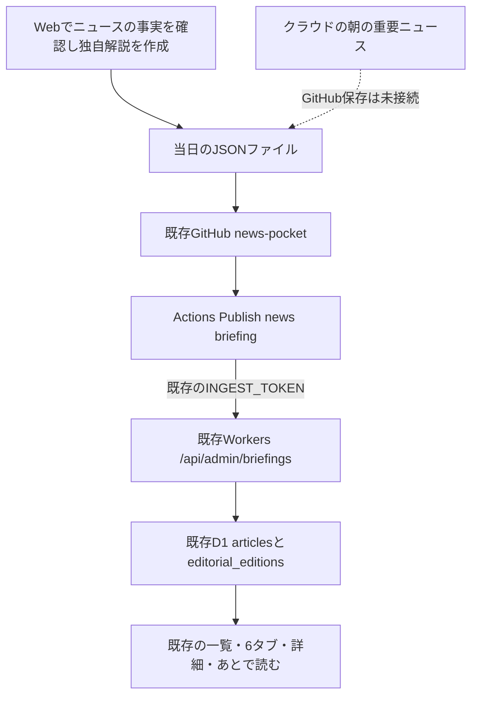

# 朝の重要ニュースを既存のニュースポケットへ載せる

更新：2026年10月16日。実装先は既存の `news-pocket` です。別アプリや別データベースは作っていません。

## 今回作ったものと、まだ接続していないもの

実装したのは、作成済みの独自ニュース解説を受け取るAPI、既存の記事一覧・6テーマ・詳細・あとで読むへの表示、GitHub Actionsからの反映処理です。サイトで記事を開くたびにAIを呼び直しません。

**既存のChatGPT「朝の重要ニュース」がGitHubへ記事データを保存する接続は未設定・未検証です。** 受信APIとActionsだけではニュースは作られません。毎朝8時に記事が自動生成・公開されることは、現時点では保証していません。PCを止めたまま動かすには、作成側もクラウド上で動く必要があります。

今回はこの制作チャットで確認したニュースを初回データとして用意し、本番へ6件反映しました。その後、[GitHubのpush反映](https://github.com/iori-doiya/news-pocket/actions/runs/38771752234)も成功し、同じ内容を重複登録しないことを確認しました。初回は定期実行の実績ではありません。公開画面・保存の確認結果は[実装・検証報告](実装・検証報告.md)に記録しています。



JSONは、項目名を決めてデータを保存するテキスト形式です。`data/briefings/2026-10-16-update.json` が実際の初回ファイルです。秘密・個人情報・記事の原文は入れません。このフォルダは公開GitHubに保存する対象です。

## 掲載する内容と情報源

日経電子版・Yahoo!ニュース・SmartNewsで知りたいような重要な話題を選ぶ方針を引き継ぎます。ただし、SmartNewsの個人向け通知や有料記事の全文を取得できる接続を作ったわけではありません。各媒体をすべて取得したとも表示しません。発表元や他の報道も確認に使えます。

記事は見出しの複製や本文の要約配信ではなく、確認した少数の事実に基づく短い独自の説明です。「何が起きた」「なぜ重要」「自分への影響」「留意点」と出典リンクを保存します。見られなかった本文を読んだことにしたり、独自取材・有料分析を言い換えて再配信したりしません。時刻が分からない出典は公開時刻を `null` にします。

`review` の4項目は作成側が行った確認の申告です。trueにすれば権利や事実が自動的に確認されるわけではありません。出典ごとの `reviewNote` に実際に確認した範囲と使い方を書きます。確認できない内容は掲載せず、空いたテーマは未掲載として扱います。RSSの利用条件が確認できていない6媒体は、引き続き `config/sources.json` で無効です。

選定基準は[ニュースの選定方針](ニュースの選定方針.md)を参照してください。媒体の全文取得・AI入力・再配信の条件は[指定6媒体の調査](指定6媒体の取得方法・AI要約可否.md)と別に扱います。

## データを手動で作成・確認する

1. このPCでエクスプローラーの `news-pocket` を開き、`data/briefings` に当日のファイルを作ります。名前は `YYYY-MM-DD-morning.json` または `YYYY-MM-DD-update.json` にします。
2. 初回ファイルを見本に項目を入力します。`id` と `issueDate` は日本の日付、`cutoffAt` は実際に確認を締めた時刻です。未来時刻で朝の便を先に作らないでください。
3. テーマは `AI`、`日本経済`、`株式投資`、`国際情勢`、`芸能ニュース`、`日本政治` のどれか。確認できた記事だけ1〜24件にします。1テーマを無理に埋める必要はありません。
4. `references` に1〜5件の出典名・公開HTTPS URL・確認日時・利用範囲・確認記録を入力します。公開日時不明は `null`。`usage` は事実のみの `facts-only`、許諾の根拠がある場合だけ `licensed` とし、後者には `licenseUrl` も必要です。
5. PowerShellをこの `news-pocket` フォルダで開き、次を実行します。

```powershell
node scripts/publish-briefing.mjs data/briefings/2026-10-16-update.json --check
```

ファイル名は実際の当日のものに置き換えてください。これは外部へ送らず、形式・必須項目・時刻・テーマ・URLを確認します。正常なら件数と未掲載テーマ数を表示します。内容の正しさ・権利・分類の妥当性は機械で保証しません。48時間より古い基準時刻、未来時刻、確認欄の不足、非公開URLは拒否します。

## GitHubから既存サイトへ反映する

既存リポジトリ `iori-doiya/news-pocket` の **Code** 画面を開きます。確認済みの当日JSONを `data/briefings` に保存し、`main` に反映します。コードの更新は従来どおりチェック・レビュー後に反映します。

`main` で当日のJSONが変更されると、**Actions → Publish news briefing** が起動します。正常ならログに「編集便 … をN件反映しました」と出ます。同じ内容を送った場合は「反映済み」と表示し、記事を重複登録しません。ファイル名を省略した実行は当日分のうち確認基準時刻が最も新しいファイルを選びます。

このActionsは日本時間8:20の定期実行も設定しています。ただしGitHubの実行は遅延・休止する場合があり、8:20ちょうどを保証しません。当日の入力がなければ何も掲載せず、最終反映時刻も更新しません。古い記事を新しい朝の記事として使い回しません。**この定期実行はニュース作成を行いません。**

接続済みの設定名は GitHub **Settings → Secrets and variables → Actions** のSecret `INGEST_TOKEN` とVariable `SITE_URL` です。既存の値を使います。値をJSONや手順書へ書かないでください。キーはこのサイトの記事登録・整理に使うもので、GoogleやCloudflareアカウント全体の操作権限ではありません。

反映後は公開サイトを再読み込みします。ホーム上部の「確認時点」と「サイト反映」を確認し、各テーマと記事詳細を開きます。ログイン中なら「あとで読む」に保存できます。最終成功時刻は新しい内容を受け取った時だけ変わります。

## PC停止中に毎朝作るための残りの設定

既存の「朝の重要ニュース」のクラウド実行で、GitHubへ書き込める接続が使えるかを確認する必要があります。この制作環境からは、そのタスクのスケジュール編集・クラウド側GitHub書き込み成功をまだ確認できていません。ローカルCodexの自動化に置き換えるとPC起動が必要になるため、代わりにはしていません。

クラウド側の接続が利用できる場合、既存タスクに追加する指示は次の内容です。設定画面で対応状況を確認してから追加し、通常のチャット応答だけでなく、実際のファイル保存・Actions成功・サイト反映まで1回検証します。

> 既存の朝の重要ニュースを続け、同じ確認結果からニュースポケット用の短い独自解説も作る。接続済みGitHubの iori-doiya/news-pocket にある docs/ニュースの選定方針.md と docs/朝タスク連携手順.md を読み、当日の data/briefings/YYYY-MM-DD-morning.json を既存形式で作成・保存する。本文・画像・有料部分を転載せず、確認できた事実・重要な理由・自分への影響・留意点・出典リンクを書く。日経・Yahoo!・SmartNewsを話題選びの軸にするが、読めなかった内容を読んだことにしない。確認できない記事は省き、6テーマを無理に埋めない。秘密を読んだり書いたりしない。保存できなければ、完了と言わず必要な接続または失敗理由を報告する。

接続が読み取り専用の場合はこの方法で自動公開できません。有料の検索APIやOpenAI APIを勝手に追加しません。手動保存なら現行の仕組みで反映できますが、それをPC停止中の全自動更新が完成したことにはしません。

## 公開コードの更新・停止・復旧

今回の受信APIは新しい列と表を使うため、初回公開前に `npm run db:remote` で **0006_editorial_briefings.sql** を適用します。既存DBを削除・再作成しません。続いて `npm run check`、`npm test`、`npm run build`、`npm run deploy` を実行します。GitHubのJSON反映は記事データだけなので、コードのCloudflare公開とは別です。

記事を直す場合は、同じ便ID・記事IDで修正したデータを反映します。保存済みの記事IDは維持します。同じ便から記事を外して反映すると、その記事と保存参照も削除されます。ファイルをGitHubから削除するだけでは、D1に登録済みの記事は削除されません。

緊急に公開停止する場合は `wrangler.jsonc` の `EDITORIAL_ENABLED` を `"false"` にしてデプロイします。データや利用者の保存は消さず、一覧・詳細・保存一覧から非表示にします。公開再開は `"true"` に戻して公開します。過去のWorkerに戻す場合も追加したDB列は削除しません。D1の削除・復元は[既存の復旧手順](AI・問い合わせ・復旧の運用手順.md)に従います。

編集便の閲覧はWorkers AIを呼ばないため、新規AI要約の1人30件・全体50件を消費しません。ChatGPT側の契約上の利用制限は別で、無制限とはしません。既存の無料枠保護・容量整理を維持します。通常の未保存記事は90日を整理の基準とし、保存記事も件数・容量整理で削除する場合があります。公開GitHubにコミットした編集便は、D1の整理後もGit履歴に残ります。個人情報は入力しないでください。

コード・データ形式・接続状態を変えたら、この手順書とREADME・検証報告も更新してください。
